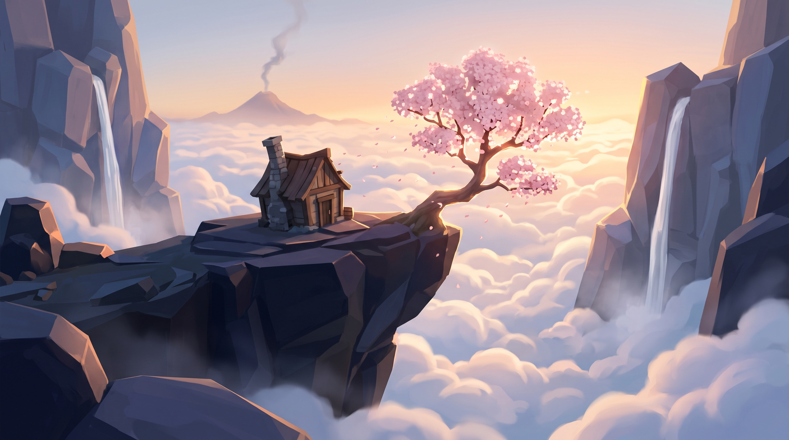
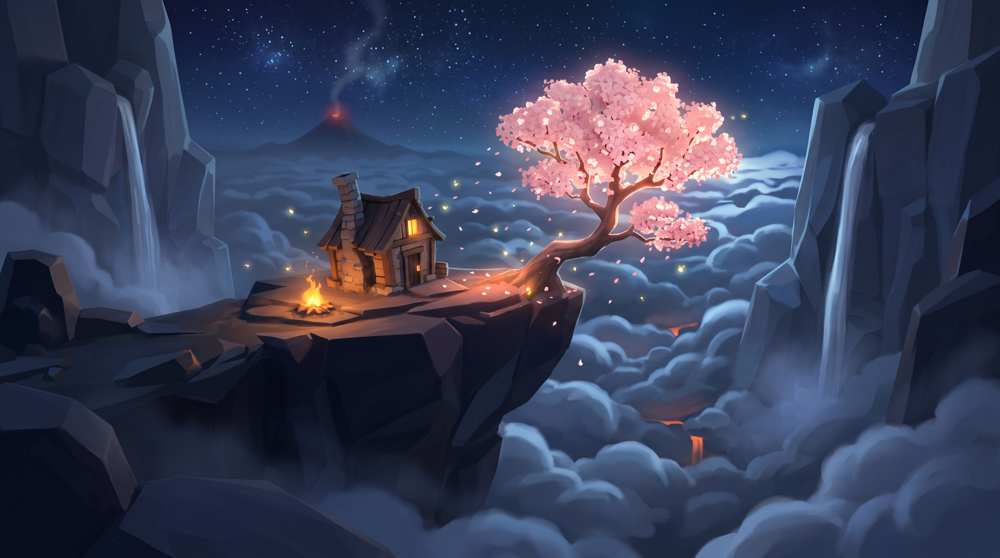
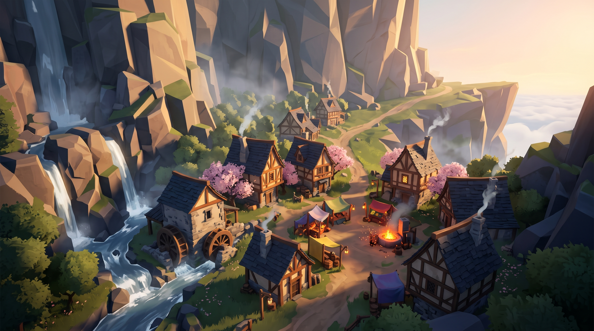
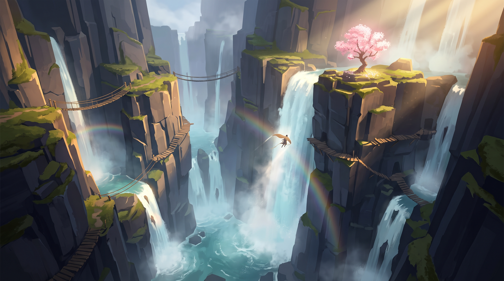
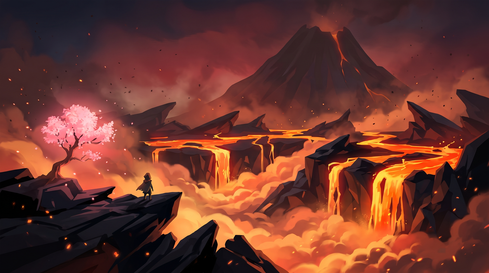
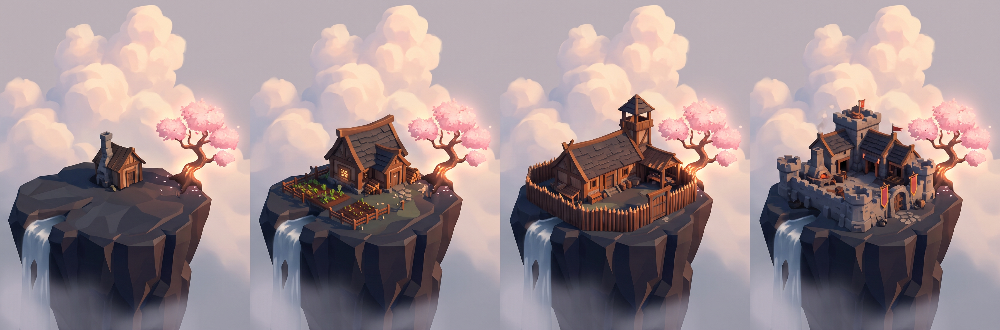
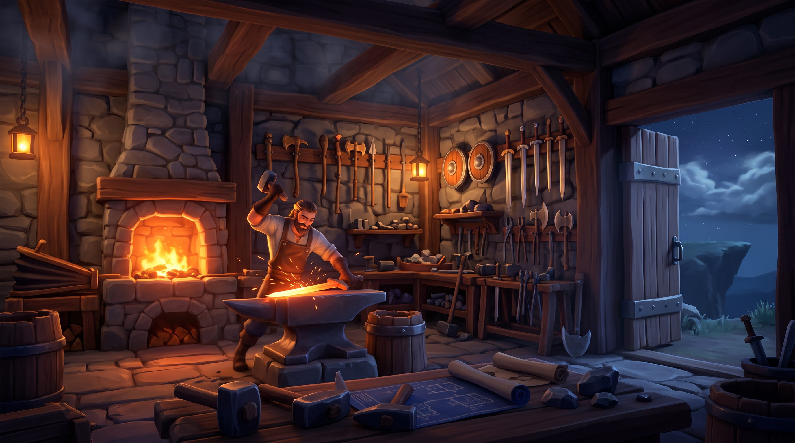
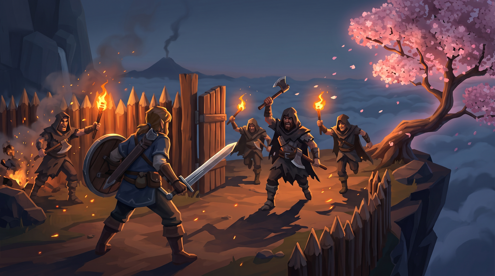
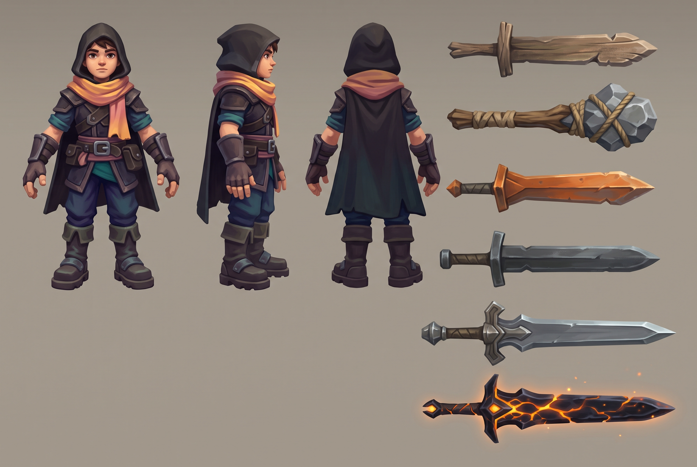
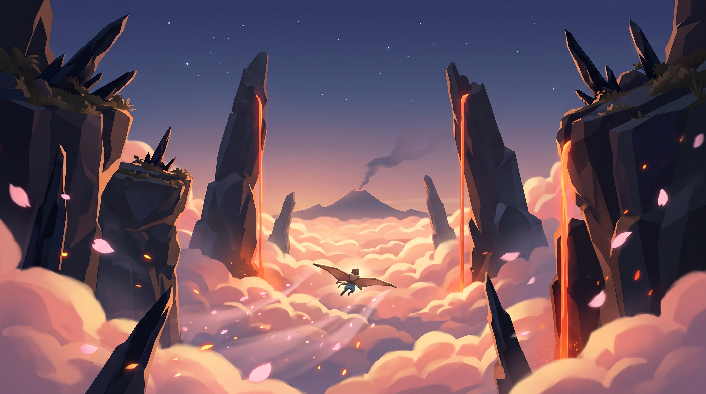

# Concept art: target looks

Generated from [concept_prompts.md](concept_prompts.md) (Gemini, 2026-11-17). These are **targets**,
not assets. Each note says what to take into the game. Godot ignores this folder (`docs/.gdignore`).

| # | Image | Zone / system | Take into the game |
|---|---|---|---|
| 1 |  | **Home Cliffs, dawn** | Lavender-blue shadows and peach light at morning. Big *flat* cloud banks with soft tops. Waterfalls fade into mist at the bottom. Tall faceted basalt columns, lit warm on one edge. The shack is small and the cliff is huge. |
| 2 |  | **Home Cliffs, night** | Night is *blue*, not black. Warm pools of light from the window, campfire and tree. Fireflies. Thin lava threads glow through gaps in the clouds. A red ember at the volcano crater. |
| 3 |  | **Ashby Village** | Timber-frame cottages with dark slate roofs (fits the Quaternius Medieval kit). A mill wheel on a waterfall stream. A market square with coloured awnings and a fire pit. Cherry trees between houses. Mossy-green tops on tan cliffs. The road climbs out to a cloud-sea overlook. |
| 4 |  | **Falls Valley** | Rope bridges and plank walkways bolted to cliffs. Turquoise pools. Rainbows in the spray. Light shafts through mist. The sanctuary tree on a high mossy ledge is the goal you can see. The glider rides the waterfall updraft. |
| 5 |  | **Volcano biome** | Red-crimson ash sky. Lava *rivers* that spill as falls into orange-lit ash clouds. Slanted obsidian slabs. The lone pink tree is a safe zone, and its glow fights the orange. |
| 6 |  | **House tiers** | Silhouettes for Shack → Cottage + garden plots → Longhouse + palisade + watchtower → Stone keep + forge + banners. The tree stays in the same spot at every tier. |
| 7 |  | **Forge interior** | Stone hearth, anvil and quench barrel. Weapon racks show your progress (swords, axes, shields). Blueprints on the bench. Warm interior against a blue night outside the open door. |
| 8 |  | **Bandit raid / combat** | Hooded bandits with torches and axes. Each has a clear silhouette and torchlight as a readable warning. Sword + round shield hero. The palisade gate is the choke point. |
| 9 |  | **Hero + sword tiers** | Hooded cloak, peach/gold scarf, teal undershirt, chunky boots and bracers. Swords: Wooden → Stone club → Bronze → Iron → Steel → Ember-forged (black blade with glowing magma cracks). |
| 10 |  | **Cloud-sea glide** | Thin lava *seams* running down spire faces (not wide sheets). Obsidian crystal clusters on cliff tops. A peach cloud sea. Big foreground petals for speed. |

## Cross-cutting takeaways for the art pass
1. **Clouds:** soft, wide, flat-bottomed banks with a warm rim on the tops (1, 5, 10). Ours are still too lumpy and lavender.
2. **Lava:** thin bright seams and rivers that pour off ledges (5, 10). Our falls are too wide and flat.
3. **Rock:** tall basalt columns with one warm-lit edge, plus mossy green tops in the valleys (1, 3, 4).
4. **Blossom tree:** a dense canopy of small florets with a few large clumps. Petals are big and readable in the foreground (all).
5. **Night:** blue-indigo base with warm light pools, not near-black (2, 7).
6. **Hero:** move toward the sheet in #9. The scarf colour is a good accent we can add to the KayKit Rogue.
